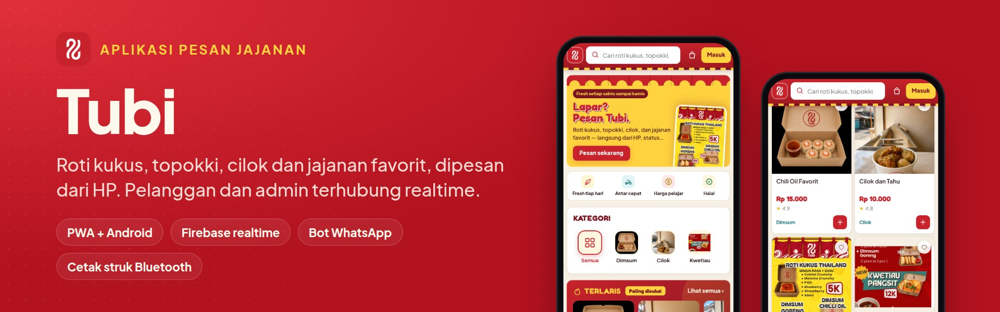
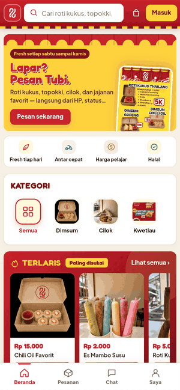
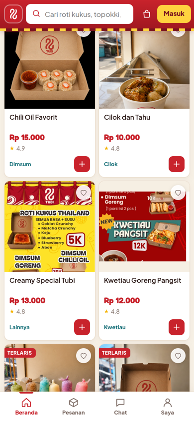

<p align="center">
  
</p>

<p align="center">
  <a href="https://tubi-opal.vercel.app"></a>
  <a href="https://github.com/ky-Mind/Tubi/releases/latest"></a>
</p>

<p align="center">
  
  
  
  
  
  
  
</p>

**Tubi** adalah aplikasi pesan jajanan (roti kukus, topokki, cilok, dimsum, dan lainnya) langsung dari HP. Pelanggan memesan, admin langsung melihat pesanannya, dan status pesanan berubah realtime di kedua sisi. Ada versi web (PWA) dan versi Android.

## Sekilas

<table>
  <tr>
    <td align="center"><br><sub>Menggulir menu</sub></td>
    <td align="center"><br><sub>Beranda</sub></td>
    <td align="center"><br><sub>Daftar menu</sub></td>
  </tr>
</table>

## Fitur utama

**Untuk pelanggan**
- Menu dengan pencarian, kategori, dan favorit
- Keranjang dan tombol **Beli sekarang**
- Titik lokasi antar di peta (GPS, cari alamat, geser pin)
- Bayar **COD** atau **transfer/QRIS** dengan unggah bukti bayar
- Chat langsung dengan admin, rating dan ulasan produk
- Tema terang/gelap otomatis

**Untuk admin**
- Dashboard pesanan realtime, ubah status dan pelanggan langsung tahu
- Kelola produk, ongkir, voucher, dan tampilan beranda
- Laporan omzet dan ekspor CSV
- Navigasi Google Maps ke titik pelanggan
- Cetak struk lewat printer Bluetooth
- Bot WhatsApp: kabar pesanan baru ke admin dan status pesanan ke pelanggan

## Cara pakai

**Langsung di browser:** buka <https://tubi-opal.vercel.app>, lalu pilih *Tambahkan ke layar utama* agar terpasang seperti aplikasi.

**Android:** unduh APK terbaru di halaman [Releases](https://github.com/ky-Mind/Tubi/releases/latest), lalu pasang (izinkan *instal dari sumber tidak dikenal* bila diminta).

**Menjalankan sendiri:**

```bash
git clone https://github.com/ky-Mind/Tubi.git
cd Tubi/www
npx serve .        # atau server statis apa pun, lalu buka http://localhost:3000
```

Sebelum dipakai sungguhan, pasang aturan keamanan Firestore dan domain login di Firebase. Langkah lengkapnya ada di [www/README.md](www/README.md).

## Struktur

```
www/        aplikasi web (PWA, tanpa bundler)
android/    proyek Android (Capacitor)
gateway/    bot WhatsApp (Cloudflare Worker + Durable Object)
```

## Gateway WhatsApp

Satu nomor WhatsApp yang mengirim kabar pesanan baru dan chat ke admin, serta kabar status pesanan ke pelanggan. Gateway berjalan sebagai Cloudflare Worker dengan satu Durable Object, jadi tidak butuh komputer yang menyala terus.

- Koneksi WhatsApp memakai Baileys. Sesi login disimpan di penyimpanan Durable Object.
- Firestore dibaca lewat REST dengan akun layanan Firebase (rahasia `FIREBASE_SA`).
- Alarm berdetak tiap 30 detik: menjaga koneksi, membaca perintah dari dashboard (`waGateway/command`), mencari pesanan dan chat baru, lalu menulis status ke `waGateway/status`.
- Pesanan baru dikenali dari `createdAt`, perubahan status dari `updatedAt` (diisi aplikasi saat status diubah).

Jalankan di komputer:

```bash
cd gateway
npm install
npm run dev
```

Simpan kunci akun layanan sebagai satu baris JSON di `gateway/.dev.vars` (tidak ikut Git):

```
FIREBASE_SA='{"type":"service_account",...}'
```

Lalu buka <http://localhost:8790/qr> untuk memindai QR (halaman ini hanya ada saat lokal; di production QR tampil di Dashboard Admin → Pengaturan → WhatsApp Bot).

Deploy: `npm run deploy` (perintah `cf`), dengan rahasia `FIREBASE_SA` diisi di Cloudflare.

---

<p align="center"><sub>Dibuat oleh <a href="https://github.com/ky-Mind">ky-Mind</a> · <a href="https://kymind.web.id">kymind.web.id</a></sub></p>
